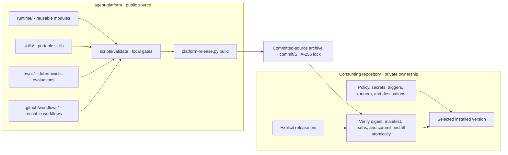

# Architecture and ownership

`agent-platform` publishes reusable runtime code, skills, evaluations, and
workflows. A consuming repository supplies its own policy, credentials, runner
ownership, and deployment targets. The public package has no dependency on a
consumer's private configuration.

Validation and release building are separate commands. The diagram shows the
intended release sequence: validate the committed source, build an immutable
archive and lock, then let a consumer verify and select a version. Installing
a release does not activate a service or change a consumer's configuration.

See the [release contract](release-contract.md) for the exact artifact checks and
the [execution router](execution-router.md) for one reusable runtime interface.
