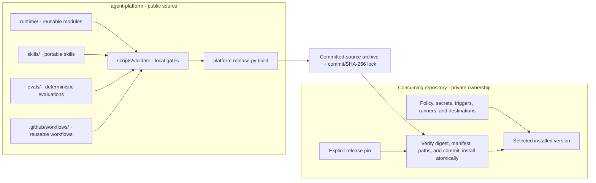
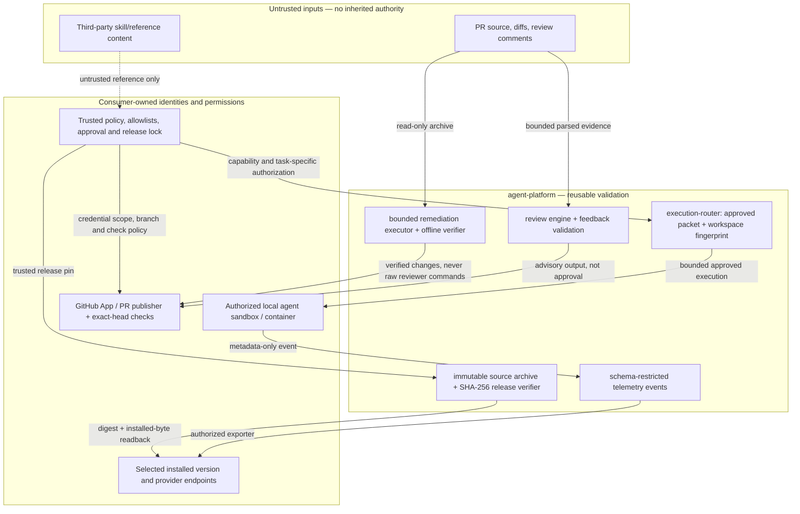

# Architecture and ownership

`agent-platform` publishes reusable runtime code, skills, evaluations, and
workflows. A consuming repository supplies its own policy, credentials, runner
ownership, and deployment targets. The public package has no dependency on a
consumer's private configuration.

Validation and release building are separate commands. The diagram shows the
intended release sequence: validate the committed source, build an immutable
archive and lock, then let a consumer verify and select a version. Installing
a release does not activate a service or change a consumer's configuration.

See the [release contract](release-contract.md) for the exact artifact checks and
the [execution router](execution-router.md) for one reusable runtime interface.

## Security trust boundaries

The generated [runtime import map](generated/runtime-map.md) shows source
dependencies, not security guarantees. These behavioral boundaries are
reviewed separately; private authorization and deployed runtime state remain
owned by each consuming repository.

Boundaries not implied by this diagram:

- The review agent receives untrusted source and feedback **without** GitHub
  publication credentials. A separate verifier and exact-head publication
  conditions remain necessary; an AI review does not approve or merge a PR.
- The execution router binds approval to a specific executable, worktree and
  source snapshot. A workspace profile is not full OS-level read confinement;
  host sandbox, MCP permissions, outbound model traffic and authorizations
  remain independent.
- A release lock authenticates a known bundle only when its source/digest is
  trusted. `platform-release.py verify` checks bundle and installed bytes but
  does not select an active runtime or establish deployed behavior.
- The telemetry contract accepts structured event metadata, not raw prompts,
  tool arguments, local file paths or credentials. Downstream exporter
  authorization and confirmation of ingestion remain separate.
- Source and generated architecture changes never enable an MCP server,
  modify consumer policies, grant a token, bypass a CI gate or deploy a service.
