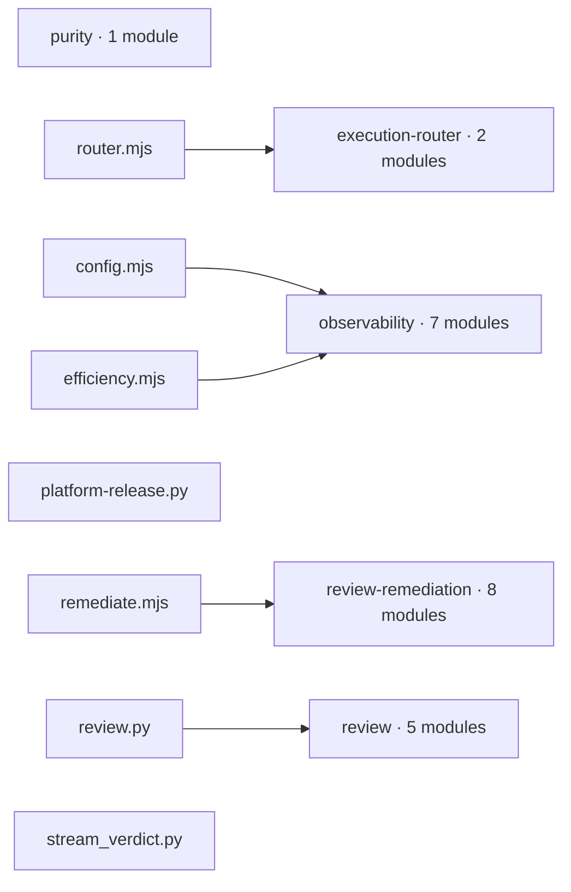
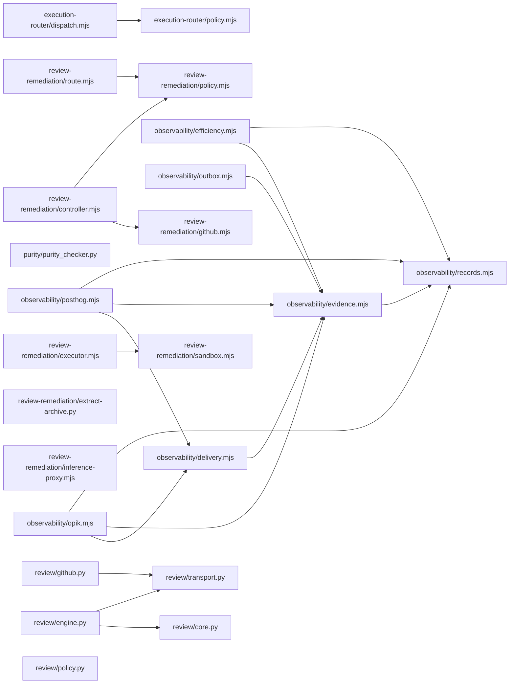

# Generated public runtime map

Generated from tracked `runtime/` modules and import statements by
`scripts/generate_architecture.py`. Edges mean a statically resolved source
import, not a deployed connection. Dynamic imports are not inferred. The
[editable Excalidraw overview](../diagrams/runtime-map.excalidraw) has the
domain-level view.

## Entrypoints and runtime domains

## Module imports

The generated views show source structure only. See
[architecture and ownership](../architecture.md) for the release and
consumer boundary, and the domain guides for behavior.
